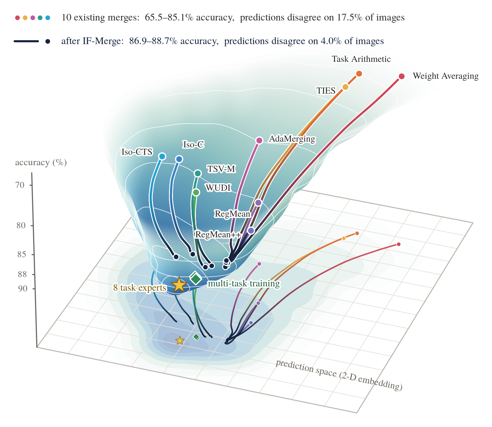
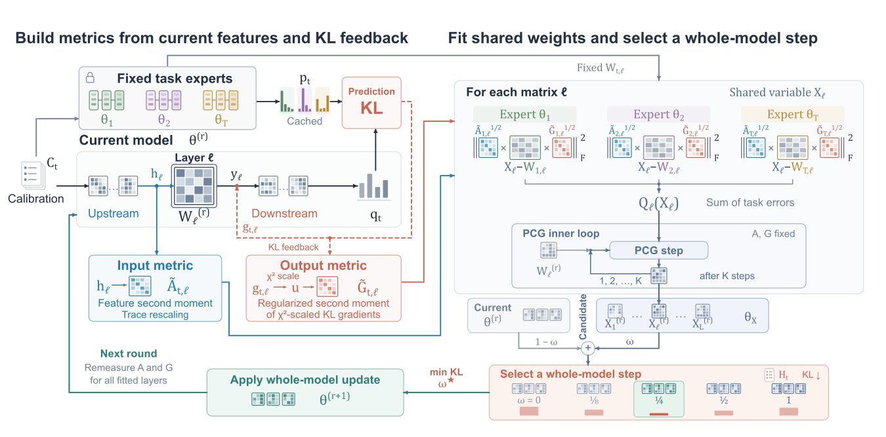

<div align="center">

# IF-Merge

### Model Merging with Iterative Function-Space Feedback

[](#citation)
[](LICENSE)




<sub>CLIP ViT-B/32 on eight tasks. Each curve follows IF-Merge from a different merged model.<br>
The landscape and mean top-1 disagreement (45 model pairs per group) use 512 test images per task.<br>
The accuracy ranges in the legend use the full test sets (seed 0).</sub>

</div>

---

**IF-Merge takes any merged model and pulls it toward its task experts — with a few hundred unlabeled
samples per task and no gradient training.** It improves every initialization we tried, from Weight
Averaging to Iso-CTS, and the endpoints land at nearly the same accuracy with much closer predictions.

- **What is new.** Merging should match the experts' *predictions*. Layerwise methods fit each weight matrix
  using its inputs only, so every output direction counts the same. IF-Merge adds the missing side:
  **function-space feedback**, the expert–merged KL propagated back to every layer, which tells the fit
  which output directions change the prediction.
- **Why iterate.** Inputs depend on the layers upstream and feedback on the layers downstream, and both move
  when the model moves. IF-Merge therefore fits all layers in parallel, takes one full-model step selected
  by holdout KL, and measures again.
- **What it costs.** 512 unlabeled images per task and about 10 minutes on one GPU for 8-task ViT-B/32.
  Each layer is a linear system solved by conjugate gradient.

<p align="center">
  <a href="figures/method.svg"></a>
</p>

For each weight matrix $\ell$, IF-Merge fits a shared candidate $X_\ell$ to the expert weights $W_{t,\ell}$ using the two metrics.

```math
X_\ell=\arg\min_X \sum_t \big\lVert A_{t,\ell}^{1/2}\,(X-W_{t,\ell})\,G_{t,\ell}^{1/2}\big\rVert_F^2
```

where $A_{t,\ell}$ is the second moment of the layer's inputs and $G_{t,\ell}$ the second moment of the
normalized expert–merged KL gradients at its output, both measured at the current merged model on task $t$.
With $G=I$ this is activation-space fitting (RegMean); with $A=G=I$ it is weight averaging.

## Results

Accuracy (%) of merging 8, 14 and 20 tasks with CLIP. IF-Merge rows are means over 3 calibration seeds.

| Method | B/32·8 | B/32·14 | B/32·20 | B/16·8 | B/16·14 | B/16·20 | L/14·8 | L/14·14 | L/14·20 |
| :-- | --: | --: | --: | --: | --: | --: | --: | --: | --: |
| Individual experts | 90.59 | 89.60 | 90.39 | 92.71 | 91.65 | 92.31 | 94.10 | 93.32 | 93.96 |
| Weight Averaging (WA) | 65.49 | 64.22 | 60.80 | 71.81 | 69.30 | 65.19 | 79.04 | 76.55 | 71.41 |
| Task Arithmetic (TA) | 69.98 | 65.07 | 60.81 | 75.63 | 70.37 | 65.46 | 83.95 | 79.09 | 73.78 |
| TSV-M | 83.72 | 79.25 | 76.57 | 87.15 | 83.73 | 80.16 | 91.30 | 88.18 | 87.15 |
| Iso-CTS | 83.40 | 80.14 | 77.28 | 89.04 | 84.92 | 81.53 | 92.92 | 89.61 | 89.24 |
| RegMean++ | 85.11 | 80.37 | 77.50 | 87.41 | 83.05 | 79.57 | 90.75 | 87.26 | 85.65 |
| **IF-Merge** + WA | 87.00 | 84.46 | 84.51 | 89.38 | 86.97 | 86.40 | 92.04 | 90.13 | 90.02 |
| **IF-Merge** + TA | 86.96 | 84.44 | 84.53 | 89.38 | 86.96 | 86.45 | 92.06 | 90.08 | 90.02 |
| **IF-Merge** + Iso-CTS | **88.81** | **86.02** | **85.62** | **91.40** | **88.75** | **88.29** | **93.75** | **91.87** | **91.92** |

The full table (12 baselines, the jointly trained reference, standard deviations), Flan-T5 results and
all ablations are in the paper; reference numbers for every run are in [`results/`](results).

| Flan-T5, 8 language tasks | WA | TA | Iso-CTS | TSV-M | RegMean | **IF-Merge** + WA | **IF-Merge** + TA | **IF-Merge** + Iso-CTS |
| :-- | --: | --: | --: | --: | --: | --: | --: | --: |
| Flan-T5-base | 78.88 | 78.89 | 81.03 | 83.54 | 83.82 | **84.86** | 84.84 | 84.79 |
| Flan-T5-large | 86.53 | 87.30 | 84.13 | 87.98 | 88.22 | 89.03 | **89.05** | 89.03 |

## Quick start

```bash
git clone <this repository> && cd IF-Merge
pip install -e ".[data]"        # add ,baselines for ReForge and ,t5 for Flan-T5

# expert checkpoints, zero-shot heads and image caches for the 8-task benchmark
if-merge prepare-clip --arch ViT-B-32 --tasks 8

# IF-Merge from Weight Averaging
if-merge clip --arch ViT-B-32 --tasks 8 --init wa
```

```text
[wa-seed0] initialization wa: 65.50
[wa-seed0] round 0: holdout KL 1.09128
[wa-seed0] round 1: holdout KL 0.28345
[wa-seed0] round 2: holdout KL 0.22171
[wa-seed0] round 3: holdout KL 0.20902
[wa-seed0] round 4: holdout KL 0.20629
[wa-seed0] 65.50 -> 87.02 (round 4)
```

The merged model is written to `runs/clip/ViT-B-32-8tasks/if_merge/wa-seed0/merged.pt` as an ordinary
open_clip visual state dict, next to a `result.json` with per-task accuracy and the record of every round.

Start from any other merge, or from your own checkpoint:

```bash
if-merge clip --arch ViT-L-14 --tasks 20 --init iso_cts          # a baseline, built on the fly
if-merge clip --arch ViT-B-16 --tasks 14 --init path/to/visual.pt --seed 1
if-merge clip --arch ViT-B-32 --tasks 8  --init ta --set g.estimator=identity   # an ablation
```

## Reproducing the paper

| What | Command | Details |
| :-- | :-- | :-- |
| IF-Merge on CLIP (Tab. 2) | `if-merge clip --arch A --tasks T --init {wa,ta,iso_cts} --seed {0,1,2}` | [`docs/REPRODUCE.md`](docs/REPRODUCE.md) |
| Merging baselines on CLIP | `if-merge baseline --arch A --tasks T --method M` | [`docs/BASELINES.md`](docs/BASELINES.md) |
| Refinement from the same initialization (LiNeS, SVC, ReForge) | `if-merge baseline --method M --init I` | [`docs/BASELINES.md`](docs/BASELINES.md) |
| Distillation with the same data | `if-merge distill --init I --images N` | [`docs/REPRODUCE.md`](docs/REPRODUCE.md) |
| Jointly trained reference (MTL) | `if-merge joint --arch A --tasks T` | [`docs/REPRODUCE.md`](docs/REPRODUCE.md) |
| Ablations and sensitivity | `if-merge clip … --set section.field=value` | [`docs/REPRODUCE.md`](docs/REPRODUCE.md) |
| Flan-T5-base and -large | `if-merge t5 --size {base,large} --init I` | [`docs/T5.md`](docs/T5.md) |
| Endpoint analyses (prediction disagreement, distances, spectral bands, interpolation paths, unseen tasks) | `python analysis/<script>.py …` | [`analysis/README.md`](analysis/README.md) |

Baselines implemented here: Weight Averaging, Task Arithmetic, TIES, TSV-M, WUDI, Iso-C, Iso-CTS, RegMean,
RegMean++, Fisher Merging, MaTS, AdaMerging, LiNeS, SVC and ReForge. Baseline hyperparameters are selected
on a labeled validation split and the selected model is evaluated once on the test split; IF-Merge uses
one fixed recipe, [`configs/if_merge/clip.yaml`](configs/if_merge/clip.yaml), everywhere.

## Using IF-Merge on another model

The method lives in [`src/if_merge/core`](src/if_merge/core) (about 500 lines) and knows nothing about
CLIP or T5. A backend tells it four things about the current merged model:

```python
from if_merge import IFMergeConfig, if_merge


class MyBackend:
    layers: dict[str, nn.Linear]  # the weight matrices to merge, live modules of the merged model
    blocks: dict[int, list[str]]  # groups for per-block step sizes
    activation_only = frozenset()  # layers fitted with G = I
    device = "cuda"

    def expert_weights(self, layer): ...  # the weight of `layer` in every expert
    def collect_statistics(self, config, round_index): ...  # A and G per task, see core/statistics.py
    def holdout_kl(self): ...  # expert–merged KL on held-out unlabeled inputs
    def state(self): ...  # a copy of the merged model


result = if_merge(MyBackend(...), IFMergeConfig.load("configs/if_merge/clip.yaml"))
```

[`clip/backend.py`](src/if_merge/clip/backend.py) and [`t5/backend.py`](src/if_merge/t5/backend.py) are
the two backends used in the paper and are short enough to copy from.

## Repository layout

```text
configs/            the IF-Merge recipe (CLIP, T5) and the hyperparameter grids of the baselines
src/if_merge/
  core/             statistics, the two-sided layerwise fit, the iterative loop
  clip/             CLIP backend, data preparation, evaluation, distillation, joint training
  t5/               Flan-T5 backend, GLUE data and evaluation
  baselines/        the fifteen merging baselines
analysis/           endpoint analyses of saved models (prediction disagreement, distances, spectral bands, paths)
docs/               REPRODUCE.md (paper tables → commands), BASELINES.md, T5.md, DATA.md
results/            reference numbers for every table
figures/            README figures and the script that draws the teaser
tests/              unit tests (CPU, no downloads)
```

## Citation

```bibtex
@article{ifmerge2026,
  title  = {IF-Merge: Model Merging with Iterative Function-Space Feedback},
  author = {Anonymous},
  year   = {2026},
  note   = {Under review}
}
```

## Acknowledgements

Expert checkpoints and zero-shot heads come from [TALL masks](https://github.com/nik-dim/tall_masks);
the Flan-T5 experts and evaluation protocol from [FusionBench](https://github.com/tanganke/fusion_bench).
We thank the authors of the baselines for releasing their code; sources are listed in
[`docs/BASELINES.md`](docs/BASELINES.md).
